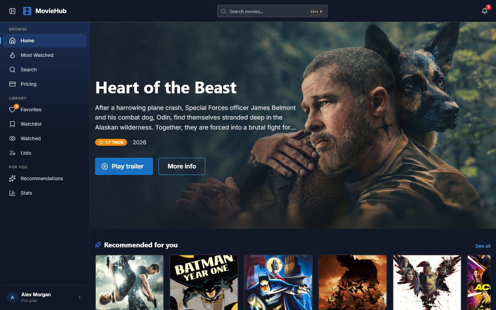
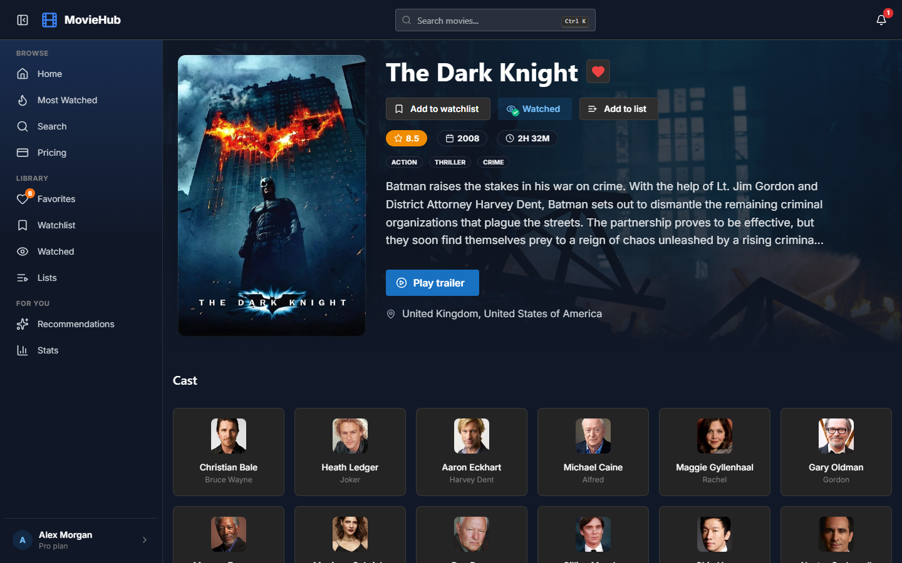
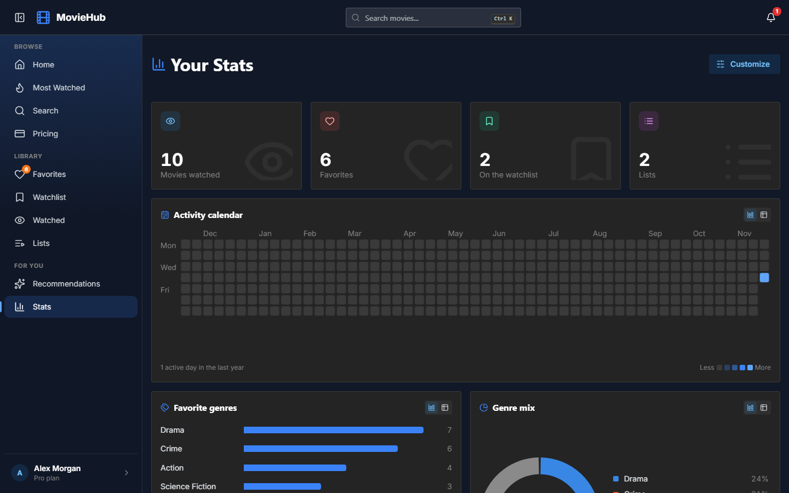
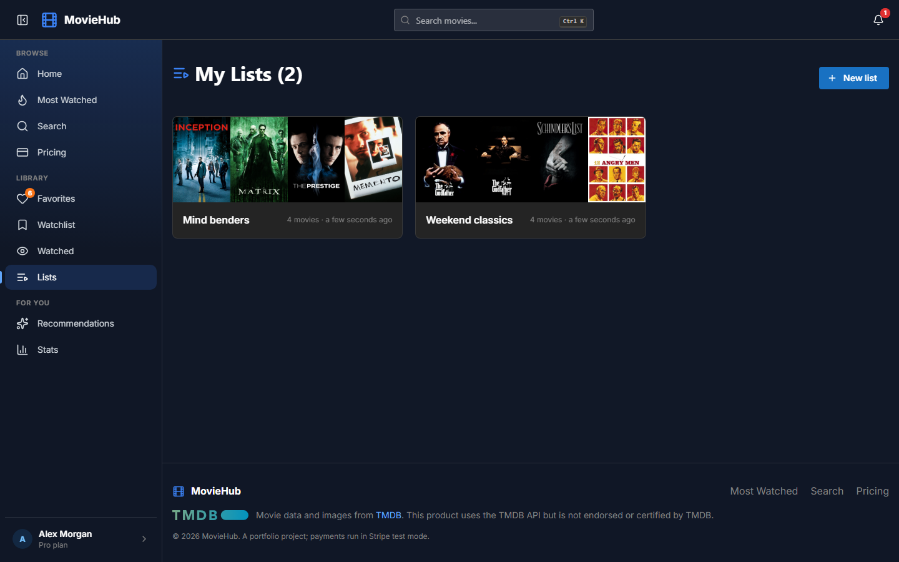
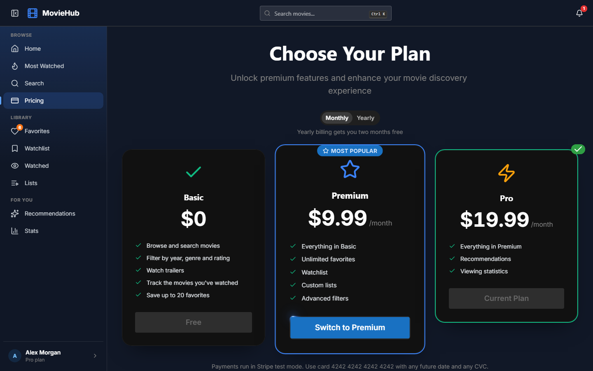
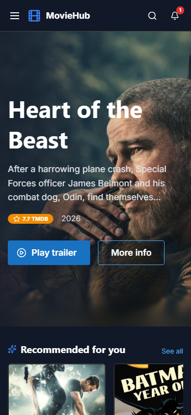
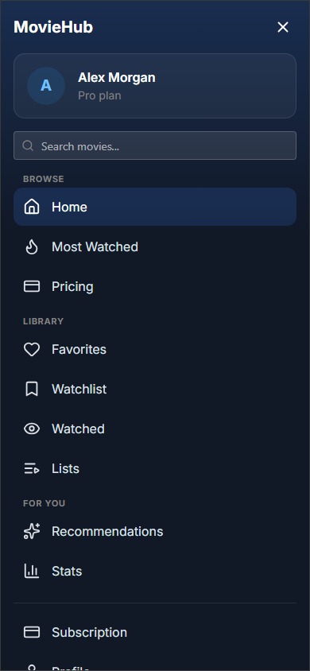
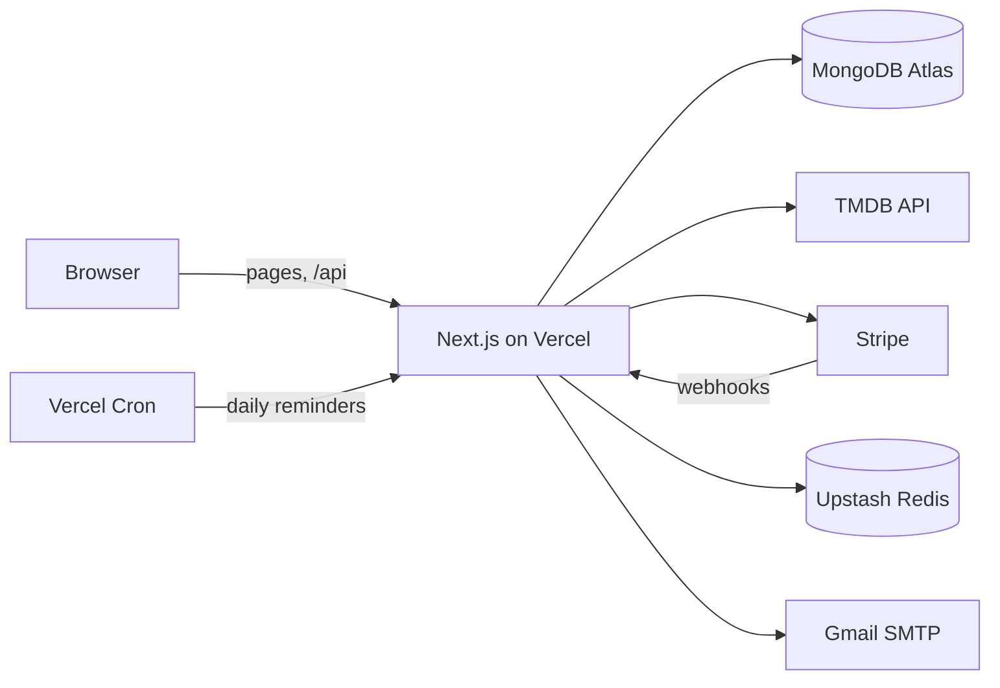

# MovieHub

[](https://github.com/HrvojeZec/movieapp/actions/workflows/ci.yml)


A movie discovery platform with accounts, three subscription plans and a personal library: browse
and search movies from TMDB, keep favorites, a watchlist, a watched history and your own lists, get
recommendations and a customizable stats dashboard. Payments run through Stripe in test mode.

**Live demo:** _the link is added with the v1.0.0 release._



## Contents

- [Features](#features)
- [Try the paid plans](#try-the-paid-plans)
- [Tech stack](#tech-stack)
- [Architecture](#architecture)
- [Running locally](#running-locally)
- [Environment variables](#environment-variables)
- [Testing](#testing)
- [How some parts work](#how-some-parts-work)
- [Known limitations](#known-limitations)
- [What I'd do differently](#what-id-do-differently)
- [License](#license)

## Features

| Plan                        | What it includes                                                                                                                            |
| --------------------------- | ------------------------------------------------------------------------------------------------------------------------------------------- |
| **Basic** (free)            | Browse, search (Ctrl+K anywhere), filter by year, genre and rating, trailers, a watched history, up to 20 favorites, recently viewed movies |
| **Premium** ($9.99 / month) | Everything in Basic, unlimited favorites, a watchlist, custom lists (reorder by dragging, swipe to remove on touch), advanced filters       |
| **Pro** ($19.99 / month)    | Everything in Premium, personal recommendations and a stats dashboard you can rearrange, resize and switch between charts and tables        |

Paid plans come monthly or yearly (two months free), with a 14-day trial on the first subscription.
Users can cancel, resume and manage billing from their profile.

Around the plans:

- **Accounts:** registration, login, password reset by email (a one-time link valid for 1 hour)
- **Notifications:** a bell in the header and emails for the welcome, subscription changes, failed
  payments, upcoming renewals and the end of a trial (a daily scheduled job sends the reminders)
- **Interface:** a collapsible sidebar, a full-screen menu on phones, server-rendered movie pages
  with share previews, motion that respects "reduce motion", keyboard access throughout

| Movie page                                | Stats dashboard (Pro)                          |
| ----------------------------------------- | ---------------------------------------------- |
|  |  |

| Lists (Premium)                      | Pricing                                  |
| ------------------------------------ | ---------------------------------------- |
|  |  |

<p>
  
  
</p>

## Try the paid plans

1. Register an account (any email works; there is no email confirmation step).
2. Open **Pricing** and pick Premium or Pro.
3. Pay on the Stripe page with the test card **4242 4242 4242 4242**, any future expiry date and any
   CVC. No real money moves: Stripe runs in test mode.

More test cards (declines, 3-D Secure) are in the
[Stripe testing docs](https://docs.stripe.com/testing).

## Tech stack

| Area        | Choice                                                                                              |
| ----------- | --------------------------------------------------------------------------------------------------- |
| Framework   | Next.js 16 (App Router, Turbopack), React 19, TypeScript                                            |
| UI          | Mantine 9, SCSS modules, Motion, Lucide icons, a few [React Bits](https://reactbits.dev) components |
| Data        | TanStack Query 5 (server state), Zustand 5 (client state), zod 4 (validation)                       |
| Backend     | Next.js route handlers, MongoDB Atlas with Mongoose 9                                               |
| Auth        | JWT in an httpOnly cookie (jsonwebtoken, bcryptjs)                                                  |
| Payments    | Stripe Checkout, Customer Portal and webhooks                                                       |
| Email       | Nodemailer over Gmail SMTP                                                                          |
| Rate limits | Upstash Redis (`@upstash/ratelimit`), in memory when Redis isn't configured                         |
| Movie data  | [TMDB API](https://www.themoviedb.org/documentation/api), called only from the server               |
| Testing     | Vitest (unit), Playwright (end to end)                                                              |
| Tooling     | ESLint, Prettier, Husky, lint-staged, commitlint, GitHub Actions, Dependabot, CodeQL                |
| Hosting     | Vercel (with a daily cron job), Docker image for self-hosting                                       |

Everything runs on free plans: Vercel Hobby, MongoDB Atlas free tier, Upstash free tier, a Gmail
account and Stripe test mode.

## Architecture



The code is organized by feature, in layers that only import downwards:

```
src/
├── app/        Routes only: thin pages (metadata + a view) and API route handlers
├── shell/      The app frame: layout, header, sidebar, phone menu
├── features/   One folder per feature: auth, movies, favorites, watchlist, watched, lists,
│               recommendations, stats, subscription, notifications, profile
├── shared/     Code used by several features, with no business logic (UI pieces, helpers, theme)
└── server/     Server-only infrastructure: database, models, HTTP helpers, rate limits, email
```

Each feature keeps the same inner layout: `api/` (client fetchers and query keys), `hooks/`, `ui/`,
`views/`, `lib/` (pure functions), `validations/` (zod schemas), `server/` (database, Stripe, TMDB)
and `__tests__/`. ESLint enforces the boundaries: client code can't import server modules, and
`shared` can't import features or the shell.

A few decisions behind it:

- **The server is the source of truth for plans.** Every paid API route checks the plan
  (`requireFeature`, 403 otherwise); the locked UI only mirrors what the server allows. Plan
  features are defined once (`PLAN_FEATURES`), and the pricing cards are built from the same list.
- **Stripe webhooks decide the subscription state.** The sync always re-reads the customer's
  subscriptions from Stripe, so events that arrive late, twice or out of order can't leave a wrong
  state. The success page only speeds up what the webhook would do anyway.
- **TMDB is only called from the server.** The key never reaches the browser, responses are cached,
  and a rate limit protects the shared quota. Movie pages and the home page render on the server.
- **Writes are atomic.** Limits such as 20 favorites or 500 movies per list are part of the database
  update itself, so two requests at once can't get past them.

## Running locally

Requirements: **Node.js 26** (see `.nvmrc`) and **npm 11.10 or newer**.

```bash
git clone https://github.com/HrvojeZec/movieapp.git
cd movieapp
npm ci
cp .env.example .env.local   # then fill in the values, see below
npm run dev                  # http://localhost:3000
```

The minimum to start is `MONGODB_URI`, `JWT_SECRET` and `TMDB_API_KEY`. Without Stripe the paid
plans can't be bought, without Gmail the emails are only logged, and without Upstash the rate limits
are counted in memory.

**Webhooks locally:** install the [Stripe CLI](https://docs.stripe.com/stripe-cli) and run
`stripe listen --forward-to localhost:3000/api/stripe/webhook`; it prints the `whsec_` secret for
`STRIPE_WEBHOOK_SECRET`.

**Docker:** `docker compose up --build` builds the production image (Node 26 Alpine, standalone
output, non-root user, health check on `/api/health`) and runs it on port 3000 with the secrets from
`.env.local`, read at runtime and never baked into the image.

**Scripts:**

| Command                                 | What it does                                 |
| --------------------------------------- | -------------------------------------------- |
| `npm run dev`                           | Development server                           |
| `npm run build` / `npm start`           | Production build and server                  |
| `npm run lint` / `npm run format:check` | ESLint (no warnings allowed) and Prettier    |
| `npm run typecheck`                     | Route types and `tsc --noEmit`               |
| `npm test` / `npm run test:coverage`    | Unit tests, optionally with coverage         |
| `npm run test:e2e`                      | End-to-end tests (builds and starts the app) |

## Environment variables

All of them are described in [`.env.example`](.env.example). In short:

| Variable                                                       | Needed for                                           |
| -------------------------------------------------------------- | ---------------------------------------------------- |
| `MONGODB_URI`                                                  | The database (required)                              |
| `JWT_SECRET`                                                   | Signing sessions (required)                          |
| `TMDB_API_KEY`                                                 | Movie data (required)                                |
| `STRIPE_SECRET_KEY`, `STRIPE_WEBHOOK_SECRET`                   | Payments and subscription updates                    |
| `STRIPE_PREMIUM_PRICE_ID`, `STRIPE_PRO_PRICE_ID`               | Monthly prices                                       |
| `STRIPE_PREMIUM_YEARLY_PRICE_ID`, `STRIPE_PRO_YEARLY_PRICE_ID` | Yearly prices                                        |
| `UPSTASH_REDIS_REST_URL`, `UPSTASH_REDIS_REST_TOKEN`           | Rate limits shared by all server instances           |
| `SMTP_USER`, `SMTP_APP_PASSWORD`, `EMAIL_FROM_NAME`            | Sending email through Gmail                          |
| `CRON_SECRET`                                                  | Protecting the daily reminder job                    |
| `APP_URL`                                                      | Absolute links in emails (Vercel sets it on its own) |
| `E2E_MONGODB_URI`                                              | A separate database for end-to-end tests             |

## Testing

- **Unit tests (Vitest):** about 650 tests for the logic that matters most: plan rules, the
  subscription sync, the dashboard grid engine, recommendation scoring, stats, validation, rate
  limits, security headers and the HTTP helpers.
- **End-to-end tests (Playwright):** about 140 tests against a production build and a separate
  database: sign-up and login, password reset with the captured email, favorites and their limit,
  watchlist, lists, filters, recommendations, the dashboard (dragging, resizing, keyboard), checkout
  up to Stripe, a real test subscription that is cancelled and resumed, notifications, reminders,
  security headers, the phone menu and layout checks. Test users are removed after the run.
- **CI (GitHub Actions):** lint, format, typecheck, unit tests and build on every pull request,
  plus a dependency audit, a Docker build and the end-to-end tests when their secrets are set. Pull
  request titles follow Conventional Commits, because they become the squashed commit message.

```bash
npm test                 # unit tests
npx playwright install   # once, for the browser
npm run test:e2e         # needs E2E_MONGODB_URI, TMDB_API_KEY and JWT_SECRET in .env.local
```

The README images come from an on-demand Playwright script:
`README_SHOTS=1 npx playwright test readme-screenshots`.

## How some parts work

**Recommendations (Pro).** The user's favorites, watched movies and watchlist build a genre
profile, weighted 3, 2 and 1 and fading with a 90-day half-life. Candidates come from TMDB's
recommendations for the five latest favorites and watched movies, plus the best-rated movies of the
two strongest genres. Each candidate is scored 50% on how many of the user's movies point to it,
35% on how well its genres match the profile and 15% on its rating. Movies the user already has
anywhere in the library are left out, and each card says why it was picked ("Because you liked …").
Without any signal yet, popular movies are shown instead.

**Stats dashboard (Pro).** A small grid engine of its own (12 columns on desktop, 6 on tablets,
1 on phones) packs widgets upwards, moves and resizes them by pointer or keyboard, and refuses
spots a widget can't take with a visible shake. The layout and each chart's chart/table view are
saved to the account.

**Reminders.** A Vercel cron job calls `/api/cron/subscription-reminders` every day at 07:00 UTC
with `Authorization: Bearer $CRON_SECRET`; it notifies users three days before a renewal, a
scheduled end or the end of a trial, once per event. On a preview deployment it can be triggered by
hand with the same header.

## Known limitations

- **Sessions are stateless JWTs.** Logging out or changing the password doesn't end sessions on
  other devices until their token expires (7 days).
- **Email goes through a Gmail account,** about 500 messages a day (the app stops at 400), and may
  land in the Promotions tab. A custom domain with a transactional email service would fix both.
- **Payments are test mode only.** This is a portfolio project; no real subscriptions are sold.
- **Movie data and images come from TMDB.** This product uses the TMDB API but is not endorsed or
  certified by TMDB.

## What I'd do differently

- **Server-side sessions** (or short-lived tokens with refresh tokens), so a logout or a password
  change could end every session at once.
- **A clean split between the movie catalogue and the library features.** Movie cards and the movie
  page show the buttons of favorites, watchlist, watched and lists, so those features and `movies`
  import each other. A composition layer above them would remove the cycle.
- **Component tests.** Unit tests run without a DOM and cover the logic; the components and hooks
  are covered only end to end. React Testing Library would catch UI regressions faster.
- **Error monitoring** (such as Sentry's free plan) instead of server logs alone.
- **Start with the data layer.** The first version fetched in `useEffect` everywhere; moving to
  TanStack Query and server rendering later touched almost every screen.

## License

[MIT](LICENSE). The components in `src/shared/vendor/react-bits` come from
[React Bits](https://github.com/DavidHDev/react-bits) under their own license (MIT + Commons
Clause); see [THIRD_PARTY_NOTICES.md](THIRD_PARTY_NOTICES.md).
